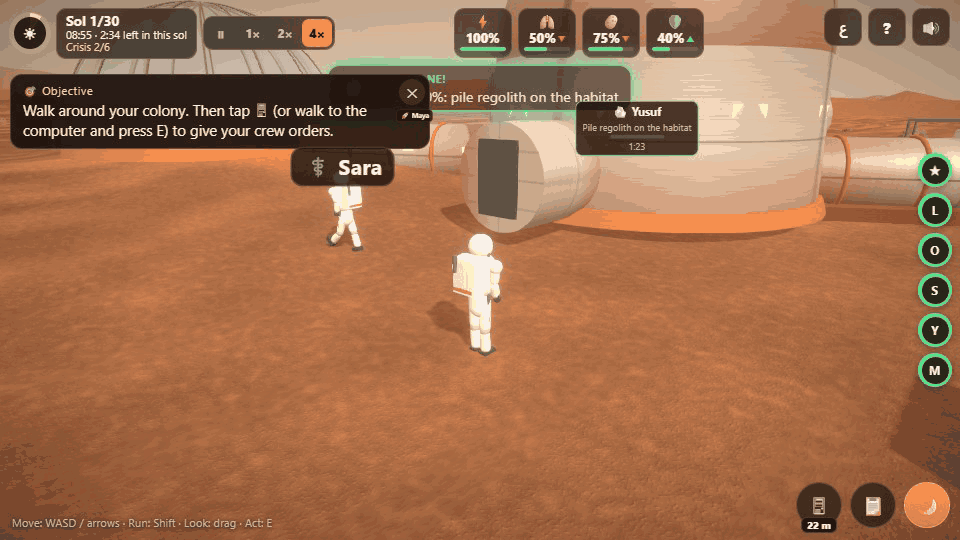

# Jezero: Sol 30 🪐

**A 3D Mars colony survival game built on real NASA data. Team AstraQuest: Malak Tamer Said Ahmad (team owner) and Rowina Walid Abdul Rahman, NASA Space Apps Challenge 2026.**

Year 2038. You command the first human colony on Mars, in the real Jezero crater. Six crew, thirty sols, six linked crises. Keep Power, Oxygen, Food and Shield up, and every decision you make will show in the world.

- 🎮 **Play in the browser (no install):** https://mistyrose-eland-246079.hostingersite.com/
- 🎞 **7-slide demo:** https://mistyrose-eland-246079.hostingersite.com/demo/Jezero-Sol-30-Demo.pdf · **Full presentation with every source:** https://mistyrose-eland-246079.hostingersite.com/presentation/
- 🌍 Arabic and English · 📱 phones and computers · 📴 works offline



## What's in the game
- **A living sol.** The sol runs by itself, from sunrise to the blue Martian sunset and night. It lasts 180 s at 1×, with ⏸ 1× 2× 4× speed buttons and a Mars clock. The four meters move live toward tonight's engine result as you change orders.
- **A crew that works.** Lina (engineer), Omar (botanist), Sara (doctor), Yusuf (geologist) and Maya (pilot) take the jobs you order. They walk to the site and work there with a progress bar and a countdown, and go inside at night.
- **Guidance for children.** A sol-1 training with a pointing hand, arrows on the ground that go around buildings, a daily goal from the colony's weakest point, and 13 illustrated hint cards (a "?" gallery, with hints on or off).
- **Six linked crises,** some carried out by you in the 3D world, and a debrief that replays the other options.
- **Visible consequences:** dust on the panels, regolith on the roof, crops growing and wilting with a harvest countdown, the reactor glowing, a damaged antenna, a medbay cross, an abandoned rover and a memorial.
- **A Mission Log** (📋) shows what is being done, how each meter will change by tonight and why, and what happened last sol.

## Controls
| | Computer | Phone |
|---|---|---|
| Walk / run | W A S D or arrows / Shift | Joystick / push to the edge |
| Look | Drag | Drag |
| Act | E | Tap the hand |
| Computer · Log · Sleep · Help | 🖥 · 📋 · 🌙 · ? | same |
- 📄 Full documentation: [docs/PROJECT.md](docs/PROJECT.md) ([PDF](docs/PROJECT.pdf)) · PRD: [docs/PRD.md](docs/PRD.md) ([PDF](docs/PRD.pdf)) · Deploy: [docs/DEPLOY.md](docs/DEPLOY.md) · Submission text: [docs/SUBMISSION.md](docs/SUBMISSION.md) · Original plan (Arabic): [plan/GAME_PLAN.md](plan/GAME_PLAN.md)

## Run locally
```bash
npm ci
npm run dev      # http://localhost:5173
npm test         # 30 unit tests
npm run paths    # balance analysis of all 486 decision paths
npm run build    # production site in dist/
```

## Real NASA assets
| Asset | Source |
|---|---|
| Terrain of Jezero crater | HiRISE DTM `DTEEC_045994_1985_046060_1985_U01` + orthoimage `ESP_045994_1985` (NASA/JPL/UArizona), CTX DTM horizon (NASA/JPL/MSSS), via USGS Astrogeology analysis-ready data |
| Perseverance rover model | NASA 3D Resources, `25042_Perseverance.glb` (NASA/JPL-Caltech) |
| Wind and rover sounds | Perseverance microphone recordings (NASA/JPL-Caltech) |

## Data sources (every number in the game)
Generated with `npx tsx scripts/sources-table.ts`, and checked against the sources with `npx tsx scripts/check-sources.ts` ([docs/SOURCES_CHECK.md](docs/SOURCES_CHECK.md)).

| Key | Value | Source | Checked | Notes |
|---|---|---|---|---|
| `oxygenPerCrewDay` | 0.816 kg/crew-day | [NASA Life Support Baseline Values and Assumptions Document (BVAD), NASA/TP-2015-218570/REV1, 2018, Table 3-33](https://ntrs.nasa.gov/citations/20180001338) | primary | Nominal oxygen used by one 82 kg crewmember per Earth day. |
| `co2PerCrewDay` | 1.04 kg/crew-day | [NASA Life Support Baseline Values and Assumptions Document (BVAD), NASA/TP-2015-218570/REV1, 2018, Table 3-33](https://ntrs.nasa.gov/citations/20180001338) | primary |  |
| `waterPerCrewDay` | 2.5 kg/crew-day | [NASA Life Support Baseline Values and Assumptions Document (BVAD), NASA/TP-2015-218570/REV1, 2018, Table 3-33](https://ntrs.nasa.gov/citations/20180001338) | primary | Drinking water plus water to rehydrate food. |
| `packagedFoodPerCrewDay` | 1.83 kg/crew-day | [NASA Life Support Baseline Values and Assumptions Document (BVAD), NASA/TP-2015-218570/REV1, 2018, section 4.3 (ISS food container)](https://ntrs.nasa.gov/citations/20180001338) | primary | Packaged ISS food per crewmember per day, including packaging. |
| `foodEnergyPerCrewDay` | 12.59 MJ/crew-day | [NASA Life Support Baseline Values and Assumptions Document (BVAD), NASA/TP-2015-218570/REV1, 2018, Table 3-33](https://ntrs.nasa.gov/citations/20180001338) | primary |  |
| `potatoYield` | 105.3 g fresh food/m²/day | [NASA Life Support Baseline Values and Assumptions Document (BVAD), NASA/TP-2015-218570/REV1, 2018, Table 4-97 (white potato)](https://ntrs.nasa.gov/citations/20180001338) | primary, simplified | Average over the whole growing cycle in NASA growth chambers. Real potatoes take about 4 months to harvest; the game speeds growth up to fit 30 sols. |
| `potatoOxygen` | 32.23 g O₂/m²/day | [NASA Life Support Baseline Values and Assumptions Document (BVAD), NASA/TP-2015-218570/REV1, 2018, Table 4-98 (white potato)](https://ntrs.nasa.gov/citations/20180001338) | primary, simplified | Oxygen released by a potato crop, averaged over its life cycle. |
| `potatoEnergy` | 3.22 MJ/kg | [USDA FoodData Central, Potatoes, flesh and skin, raw (FDC 170026). NOT NASA](https://fdc.nal.usda.gov/food-details/170026/nutrients) | primary, **not NASA** | 77 kcal (322 kJ) per 100 g, read from the FoodData Central record. Used to turn the harvest into crew-days of food. |
| `issWaterRecovery` | 0.98 fraction | [NASA: NASA Achieves Water Recovery Milestone on International Space Station (2023)](https://www.nasa.gov/missions/station/iss-research/nasa-achieves-water-recovery-milestone-on-international-space-station/) | primary |  |
| `electrolysisWater` | 1.125 kg water per kg O₂ | [Derived: water (H₂O) is 8/9 oxygen by mass](https://ntrs.nasa.gov/citations/20180001338) | derived | Splitting 1.125 kg of water gives 1 kg of oxygen and 0.125 kg of hydrogen. |
| `solarIrradianceMars` | 586.2 W/m² | [NASA NSSDC Mars Fact Sheet](https://nssdc.gsfc.nasa.gov/planetary/factsheet/marsfact.html) | primary | Top of the atmosphere. 43% of the sunlight at Earth. |
| `solDuration` | 24.6597 hours | [NASA NSSDC Mars Fact Sheet](https://nssdc.gsfc.nasa.gov/planetary/factsheet/marsfact.html) | primary | One sol is 24 h 39 min 35 s. |
| `marsGravity` | 0.38 × Earth | [NASA NSSDC Mars Fact Sheet](https://nssdc.gsfc.nasa.gov/planetary/factsheet/marsfact.html) | primary |  |
| `marsCO2` | 95.1 % of the air | [NASA NSSDC Mars Fact Sheet](https://nssdc.gsfc.nasa.gov/planetary/factsheet/marsfact.html) | primary |  |
| `marsPressure` | 6.36 mbar | [NASA NSSDC Mars Fact Sheet](https://nssdc.gsfc.nasa.gov/planetary/factsheet/marsfact.html) | primary | Less than 1% of Earth’s air pressure. Astronauts need pressure suits outside. |
| `marsNightTemp` | -70 °C | [NASA: Steady Temperatures at Mars’ Gale Crater (Curiosity REMS)](https://science.nasa.gov/photojournal/steady-temperatures-at-mars-gale-crater) | secondary | Typical night low of the air at Gale crater; daytime highs were near 0 °C. |
| `marsDayTemp` | 0 °C | [NASA: Steady Temperatures at Mars’ Gale Crater (Curiosity REMS)](https://science.nasa.gov/photojournal/steady-temperatures-at-mars-gale-crater) | secondary |  |
| `blueSunset` | 956 sol of the Curiosity mission | [NASA Photojournal PIA19400: Sunset in Mars’ Gale Crater (Curiosity, 15 April 2015)](https://science.nasa.gov/photojournal/sunset-in-mars-gale-crater/) | primary | Fine dust lets blue light through near sunset, so Martian sunsets are blue. |
| `marsSurfaceDose` | 0.67 mSv/day | [Curiosity RAD (NASA MSL), Hassler et al. 2014, Science 343 (doi:10.1126/science.1244797), as stated by the RAD principal investigator in the SwRI release](https://swri.org/node/9079) | secondary, simplified | Over 30 sols this adds up to only ~20 mSv. The game’s Shield meter therefore stands for protection against solar storms and the environment. |
| `solarStorm2024` | 8.1 mGy in one event | [NASA: NASA Watches Mars Light Up During Epic Solar Storm (2024)](https://www.nasa.gov/solar-system/planets/mars/nasa-watches-mars-light-up-during-epic-solar-storm) | secondary, simplified | Largest solar storm Curiosity’s RAD measured on the surface (20 May 2024). |
| `waterShielding` | 0.102 m (one water-container wall) | [Dugan et al. 2015, Deep Space Storm Shelter Simulation Study (NASA Langley, RadWorks), NTRS 20160006051](https://ntrs.nasa.gov/citations/20160006051) | primary, simplified | NASA’s RadWorks project studied storm shelters walled with stored water, because water “provides good shielding properties”. In this study each water-container wall is 0.102 m thick. The game’s water-wall option stands for this idea. |
| `solarCellEfficiency` | 0.307 fraction | [NASA State-of-the-Art of Small Spacecraft Technology, Power chapter: space solar cell efficiencies (Spectrolab XTJ-Prime, 30.7%)](https://www.nasa.gov/smallsat-institute/sst-soa/power-subsystems/) | primary, simplified | Efficiency of a modern triple-junction space solar cell. The game assumes the colony’s panels use cells of this class. |
| `moxieRate` | 12 g O₂/hour (best) | [NASA: NASA’s Oxygen-Generating Experiment MOXIE Completes Mars Mission (2023)](https://www.nasa.gov/missions/mars-2020-perseverance/perseverance-rover/nasas-oxygen-generating-experiment-moxie-completes-mars-mission/) | primary | Twice NASA’s original goal for the instrument. MOXIE made 122 g of oxygen in total. |
| `moxiePower` | 300 W | [NASA Science: Perseverance science instruments, MOXIE (Power: 300 watts)](https://science.nasa.gov/mission/mars-2020-perseverance/science-instruments/) | primary, simplified | About 25–50 kWh per kg of oxygen at MOXIE’s size. A crew-size unit is assumed to reach the efficient end of that range. |
| `dustStormTau2018` | 10.8 optical depth (tau) | [NASA JPL: Opportunity Hunkers Down During Dust Storm (2018)](https://www.jpl.nasa.gov/news/opportunity-hunkers-down-during-dust-storm/) | secondary, simplified | Record dust over Opportunity; normal is about 0.5. The game storm is shorter and a bit weaker. |
| `kilopowerOutput` | 10 kWe (up to) | [NASA Kilopower / KRUSTY (NTRS 20180005435)](https://ntrs.nasa.gov/citations/20180005435) | secondary, simplified | Kilopower designs span 1–10 kWe; the game’s standby reactor is the 10 kWe size. |
| `ingenuityFlights` | 72 flights | [Ingenuity Mars Helicopter (NASA JPL), reported by Live Science](https://www.livescience.com/space/mars/nasas-historic-ingenuity-helicopter-ends-its-3-year-mars-mission-suffering-rotor-damage-on-72nd-flight) | secondary | Planned for 5 flights; flew 72 times from 2021 to January 2024. |
| `lightDelayMin` | 3 minutes | [Derived from the NASA Mars Fact Sheet: minimum Earth–Mars distance 54.6 million km ÷ speed of light](https://nssdc.gsfc.nasa.gov/planetary/factsheet/marsfact.html) | derived | 54.6 million km takes 3.0 minutes at the speed of light. The game computes the real distance for the mission date with JPL’s approximate planet positions (ssd.jpl.nasa.gov/planets/approx_pos.html). |
| `lightDelayMax` | 22.3 minutes | [Derived from the NASA Mars Fact Sheet: maximum Earth–Mars distance 401.4 million km ÷ speed of light](https://nssdc.gsfc.nasa.gov/planetary/factsheet/marsfact.html) | derived | 401.4 million km takes 22.3 minutes at the speed of light. |

## Built with
TypeScript · React · three.js · React Three Fiber · drei · postprocessing · zustand · Vite · vite-plugin-pwa · Vitest · Puppeteer · geotiff.js · glTF-Transform · FFmpeg · PHP + SQLite. AI assistance: Claude Code ([docs/PROJECT.md §12](docs/PROJECT.md)).
