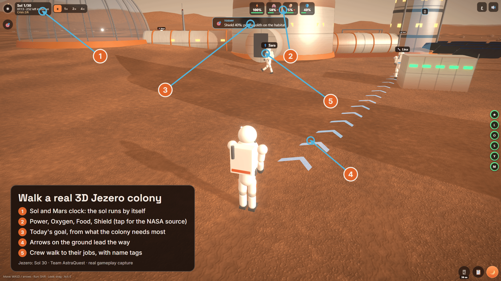

# Jezero: Sol 30 — Project Documentation

**Team:** AstraQuest · **Team members:** Malak Tamer Said Ahmad (team owner), Rowina Walid Abdul Rahman
**Event:** NASA Space Apps Challenge 2026 · **Challenge:** Build a Junior Astronaut Mission Trainer
**Play (browser, no install):** https://mistyrose-eland-246079.hostingersite.com/
**Source code:** https://github.com/ElQammash/jezero-sol-30
**7-slide demo (PDF):** https://mistyrose-eland-246079.hostingersite.com/demo/Jezero-Sol-30-Demo.pdf
**Full presentation with every source:** https://mistyrose-eland-246079.hostingersite.com/presentation/ ([PDF](https://mistyrose-eland-246079.hostingersite.com/presentation/Jezero-Sol-30-Full-Presentation.pdf))



---

## 1. Summary

*Jezero: Sol 30* is a 3D game that runs in the web browser on computers and phones. It is for students aged 10 to 14.

It is the year 2038. The player is the commander of the first human colony on Mars, in **Jezero crater**, the real place where NASA's Perseverance rover landed. The player walks around the base as an astronaut, in a world built from **real NASA terrain data**. Over **30 sols** (Martian days), six crises arrive one after another:

- choosing where to build the habitat
- choosing the life-support system
- a dust storm
- a broken rover
- a delayed solar-storm warning from Earth
- a medical emergency

Every decision changes four meters (**Power, Oxygen, Food, Shield**) and the health of the six crew. Choices also have delayed effects on later crises. A wrong choice can cost a life or the whole colony. At the end, a debrief replays the mission with the other options and shows the decision that mattered most. The player can then retry from that crisis.

The colony is alive while you play:
- **The sol runs by itself.** The sun moves from sunrise to the blue Martian sunset and night, and you can pause or play at 1×, 2× or 4×.
- **The meters move live** as a result of your orders.
- **Named crew walk to their jobs** and do them in the world, with a progress bar and a countdown.
- **Crops grow** with a countdown to harvest.
- **A daily goal**, taken from what the colony needs most, and **arrows drawn on the ground**, tell a 10-year-old where to go and what to do next.

## 2. How it answers the challenge

| What the judges look for | How the game delivers it |
|---|---|
| **Trade-offs felt through play, not explained in text** | Every option has a cost and a benefit, and the crises are linked. Mining ice needs more power, so the dust storm becomes more dangerous. A farm makes food and oxygen, but its plants die if the power is cut in the storm. The effects show in the world: the habitat lights dim, plants wilt, regolith piles up on the roof, the storm swallows the sky. |
| **Real NASA data** | The ground is a real HiRISE elevation model of Jezero crater. The rover is NASA's own 3D model of Perseverance. The wind is a real recording from Perseverance's microphone on Mars. Crew needs, radiation, sunlight, MOXIE, Kilopower, the 2018 dust storm and the Earth–Mars light delay all come from NASA sources (29 values, §9). Every number has a **Source** button, and simplified numbers are labelled. |
| **A 10–14-year-old can play without instructions** | Sol 1 has a short step-by-step training with a pointing hand on the real button. Blue arrows are drawn on the ground to every target, and they go around buildings. A daily goal comes from the colony's weakest point. 13 illustrated hint cards (real annotated screenshots) appear the first time each situation happens, and the "?" button shows them all. Decisions are big cards with cost icons. Everything is in Arabic (right-to-left) and English. |

## 3. The story

> Year 2038. NASA has sent the first crew to build a colony on Mars. You landed in Jezero crater, where the Perseverance rover explored an ancient river delta. There are six of you. You have 30 sols to prove people can live here. Supplies are limited. Help from Earth is months away. Every decision counts.

At the start, the player chooses to be the commander (male) or the commander (female). The Arabic text then addresses them in the matching form. The crew are an engineer, a botanist, a doctor, a geologist and a pilot, each with a health ring on screen.

## 4. How to play: every control and button

### 4.1 Controls

| Action | Computer | Phone / tablet |
|---|---|---|
| Walk | W A S D or arrow keys | On-screen joystick (bottom-left) |
| Run | Shift | Push the joystick to the edge |
| Look around | Drag with the mouse | Drag on the screen |
| Zoom | Mouse wheel | — |
| Interact | **E** (or click the prompt) | Tap the prompt |

### 4.2 Screens and buttons

- **Title screen.** Choose the commander (he/she), the graphics quality (Low / Medium / High), the language (العربية / English), and **Cloud save**. Then press **Start mission** (or **Continue** if a mission is saved).
- **Intro.** Four lines of story. Tap to go faster, or press **Skip**.
- **Training (sol 1, first time only).** Ten short steps, one at a time, with a hand pointing at the exact button or place: look around, walk to the glowing circle, run, open the base computer, give an order, close it, read the meters, read the Mars clock, change the speed, and see today's goal. Time is paused during the training. It can be skipped, and it can be replayed from the title screen (🎓).
- **HUD (in game):**
  - **Top-left:** a day/night ring, the sol counter (Sol 1/30), the **Mars clock** with the time left in the sol, the crisis number, and the **speed buttons** ⏸ 1× 2× 4×. Time also pauses by itself while a crisis card, the computer, a hint card or the training is open, and during in-world actions.
  - **Top centre, under the meters:** **today's goal**, for example "Dust storm in 2 sols: clean the solar panels". It turns green when done. Tap it to open the computer.
  - **Meter trend arrows:** ▲ or ▼ on each meter shows where it is heading by tonight.
  - **Top:** four small meters, *⚡ Power, 🫁 Oxygen, 🥔 Food, 🛡 Shield*. Each turns yellow below 40% and flashes red below 20%. Tap a meter to see how many sols it will last and its **Source** button.
  - **Top-right:** language switch, **? help** (the gallery of all hint cards, with "Hints on/off" and "Show hints again"), and mute.
  - **Right side:** six small crew circles. The ring is their health. Tap one for name, job and health. 🤒 means sick, 🩹 means injured.
  - **🎯 Objective:** opens by itself when there is a new goal, then folds into an icon. Tap it to open, ✕ to close.
  - **Direction pill:** an arrow and the distance in metres to where you need to go. A red countdown appears when time is short.
  - **Ground arrows:** animated chevrons on the ground lead from you to the target, bending around buildings, with a pulsing circle at the end.
  - **Beacon:** a pillar of light in the world over the place you must reach. It turns red when urgent.
  - **Crew name tags:** each crewmember shows their name. While working, the tag also shows the job, a progress bar and a countdown.
  - **Computer marker:** a 🖥 icon always floats over the base computer.
  - **Bottom-right:** 🖥 **Base computer** (with the distance to it), 📋 **Mission log** (today's jobs in progress, how each meter will change by tonight and why, and what happened last sol), and 🌙 **Sleep until morning** (optional; it fast-forwards the rest of the sol).
- **Base computer** (also at the tower door or the habitat airlock):
  - Shows today's **power forecast**: made vs used.
  - **Crew tasks** (choose 2 per sol): clean the solar panels, pile regolith on the habitat (surface habitat only), maintenance, tend the farm (farm only), crew rest. Each chosen job shows who will do it (for example "→ Lina · Engineer"): the healthy crewmember whose role fits best.
  - **Systems:** smaller food portions, heating down, farm lights, ice plant, MOXIE (each shows its power use).
  - **Sleep until morning.**
- **The sol.** One sol lasts 180 seconds at 1× (most of it daylight; the night passes faster). The sun crosses the sky and sets blue, night falls (the crew go inside), and a new morning comes with a "Sol N begins" message. The Mission Log keeps the report.
- **Hint cards.** The first time something new happens (the first crisis, a timed action, the dust storm, the farm, the crew at work, the Source button, the debrief), a card with a real annotated screenshot and one short sentence appears, and time pauses until "Got it". Each card is shown once.
- **Crisis card.** An alarm sounds and the camera flies to the place in trouble. Two or three option cards show their **costs** (red) and **gains** (green) as icons. Options marked 🕹 must be done by the player in the world.
- **Outcome.** What happened, the change in each meter, and a **NASA fact** with its **Source**.
- **End screen.** Win or loss, 1 to 3 stars, **the decision that mattered most** (from replays), a mission timeline chart, **Try again from this crisis**, and **Start a new mission**.

### 4.3 Winning and losing

**You win** if three things are true at the end:
- You complete 30 sols.
- All six crew are alive.
- The Shield is above 50%.

**You lose** if any of these happens:
- The oxygen runs out.
- A crewmember dies, from cold, CO₂, hunger, thirst, radiation, injury or illness.
- The shield is 50% or less at the end.

## 5. The six crises

| Sol | Crisis | Options (trade-offs) |
|---|---|---|
| 1 | **HABITAT: where do we build?** | **A. Surface:** ready today, but the shield starts at 40% and must be built up with regolith. **B. Underground:** 3 sols of digging in spacesuits (extra power, oxygen and crew strain, with a small chance of a cave-in), then the shield is 90%. |
| 4 | **LIFE SUPPORT: water, oxygen and food** | **A. Mine buried ice:** 42 kg water and 5.5 kg oxygen per sol, but it needs 75 kWh a sol and the rover. **B. Farm:** potatoes give fresh food and oxygen (NASA crop data), but it is slow to start, needs 110 kWh a sol, water, and daily care. **C. MOXIE:** oxygen from Martian air, but very power-hungry (125 kWh a sol), with no water or food. |
| 9 | **POWER: dust storm** (4 sols, optical depth up to 6) | **A. Start the backup reactor:** walk to it yourself through the storm. Risky now, 246 kWh a sol after. **B. Save power:** heating and farm lights down, ice plant off. **C. Send crew out to clean the panels every sol:** more power, risky spacewalks. |
| 14 | **MOBILITY: the rover broke down** | **A. Send two astronauts:** walk to the garage yourself. Likely to work, but costs oxygen and gives them a radiation dose. **B. Send the robot:** NASA's Perseverance model, with Ingenuity-style scouting. No human risk, but it costs power and fails more often when equipment is worn. **C. Abandon it:** lose the ice plant, or the supply drop of food and oxygen. |
| 20 | **COMMUNICATION: a warning from Earth** | The warning arrives late because of the real Earth–Mars light delay for the story date (≈21 minutes). **A. Everyone to the shelter:** run to the airlock yourself before the countdown ends. **B. Keep working:** the two crew outside take a big dose and get radiation sickness. **C. Water wall:** 150 kg of stored water shields the crew room. |
| 26 | **SAFETY: the hardest decision** | The weakest crewmember falls seriously ill. **A. Full medbay treatment:** power and extra oxygen for 3 sols. **B. Share the oxygen:** everyone loses a little health. **C. Wait and watch:** saves supplies, but the patient may die. The doctor's own health improves the odds. |

**The crises are linked.**
- Choosing ice makes the storm harder, because ice needs more power.
- Choosing the farm makes "save power" dangerous for the plants.
- A surface habitat makes the solar storm more dangerous.
- The water wall is only possible if you still have water.
- The sick crewmember in crisis 6 is usually the one who did the most dangerous work earlier.

**Between crises:**
- Panels gather dust every sol (more in storms).
- Equipment wears out, so failures become more likely without maintenance.
- Small random events happen, such as dust devils, leaks and CO₂ spikes.

## 6. How the meters work (real units underneath)

| Meter | Real quantity | Uses per sol | Main sources |
|---|---|---|---|
| ⚡ Power | Battery charge (300 kWh) vs. production | Life support 85 kWh, heating 20–40, plus the machines you run | Solar: 300 m² × 586.2 W/m² (NASA) × 30.7% space solar cell efficiency (NASA Small Spacecraft State-of-the-Art) × dust transmission e^(−0.35·τ) × day/angle factor. Reactor: 10 kWe (Kilopower). |
| 🫁 Oxygen | Stored O₂ in kg (tank 220 kg) | 6 × 0.816 kg × 1.0275 (sol length) = 5.03 kg, plus spacewalks | Ice electrolysis (1.125 kg of water per kg of O₂), MOXIE (~25 kWh/kg), plants (32.23 g/m²/day, NASA BVAD). |
| 🥔 Food | Stored food in kg (380 kg) | 6 × 1.83 kg × 1.0275 = 11.3 kg | Farm: 105.3 g/m²/day of potato (NASA BVAD) → energy (USDA) → crew-days. |
| 🛡 Shield | Protection rating 0–100 | Lowered by dust storms and by working through a solar storm | Habitat type, regolith piled by the crew, water wall. |

Crew **health** goes down with cold (no power at night: Mars nights reach about −70 °C), CO₂ build-up, hunger, thirst, smaller portions, cramped quarters, injuries, radiation sickness and illness. It goes up with rest.

**Live meters.** During the sol, the HUD moves each meter from its morning value toward the engine's result for tonight. That result is recomputed the moment an order changes, so the player sees the effect at once. At the end of the sol the meters land exactly on the engine's result, and a unit test checks this. The rules still settle each sol in one step (`endSol()`), so the balance analysis is unchanged.

**What you see in the world:**
- Dust builds up on the panels, and cleaning removes it.
- Regolith piles up on the habitat roof.
- Potatoes go from seeds to seedlings to growing plants to harvest, with a countdown, and wilt when the lights are off or nobody tends them. A note says real potatoes take about 4 months (NASA BVAD) and that the game speeds this up.
- The reactor glows green when it runs.
- A damaged antenna tilts and blinks red.
- A red medbay cross lights up while a patient is treated.
- An abandoned rover stays where it broke down.
- A memorial stone appears if someone dies.

## 7. Debrief: "the decision that mattered most"

When the mission ends, the game replays **every crisis** from the exact moment it happened. Each alternative option is played many times, with the same careful daily routine and different luck. If the mission was lost, the debrief shows the earliest crisis where another option clearly did better. For example: *"Sol 9, POWER: you chose 'Save power'. Replays show 'Start the backup reactor' would have survived 100% of the time."* If the mission was won, it shows the choice that helped most. **Try again from this crisis** restores that exact moment.

## 8. Balance, tested with thousands of simulated missions

`npm run paths` plays **every combination of decisions** (2 × 3⁵ = 486 paths), each 60 times with different luck. It also plays a random player and a thoughtful player who looks ahead.

| Player | Win rate |
|---|---|
| Random (random choices and random daily tasks) | **21.6%** |
| Random choices, careful daily tasks | 48.4% |
| **Thoughtful** (looks ahead before each decision) | **89.2%** |

| Decision paths by win rate | 0% | 1–25% | 25–50% | 50–75% | 75–99% | 100% |
|---|---|---|---|---|---|---|
| Number of paths (out of 486) | 127 | 38 | 30 | 117 | 170 | 4 |

No single option wins on its own. The average win rate of the paths that contain each option is between 18% and 64% (`docs/balance-report.txt`). The best choice depends on what you chose before.

## 9. NASA data and honesty about simplifications

Every real number is in one file, `src/data/nasa.ts`. Each entry has its value, unit, source name, link, a **simplified** flag, how it was checked (**primary** = read in the original document; **secondary** = confirmed through reports of the original; **derived** = calculated by us), and whether the source is NASA. Gameplay-only values (tank sizes, storm length, chances) are kept separately in `src/engine/tuning.ts` and are never shown as NASA data.

### What we were honest about
- **30 sols of real Mars surface radiation is only about 20 mSv.** That is far below NASA's 600 mSv career limit. So the Shield meter stands for protection from solar storms and the environment, and the Source button says so.
- **Crops grow faster than in reality.** Real potatoes take about 4 months. The game speeds this up to fit 30 sols.
- **The storm is shorter and weaker than the real 2018 storm** (optical depth 6 vs 10.8).
- **The game's MOXIE is crew-sized.** Its power cost uses the efficient end of MOXIE's real range of about 25–50 kWh per kg.
- **Potato food energy comes from USDA**, and is labelled "not NASA".

### Full data table
(Generated from the data file with `npx tsx scripts/sources-table.ts`.)

| Key | Value | Source | Checked | Notes |
|---|---|---|---|---|
| `oxygenPerCrewDay` | 0.816 kg/crew-day | [NASA Life Support Baseline Values and Assumptions Document (BVAD), NASA/TP-2015-218570/REV1, 2018, Table 3-33](https://ntrs.nasa.gov/citations/20180001338) | primary | Nominal oxygen used by one 82 kg crewmember per Earth day. |
| `co2PerCrewDay` | 1.04 kg/crew-day | [NASA Life Support Baseline Values and Assumptions Document (BVAD), NASA/TP-2015-218570/REV1, 2018, Table 3-33](https://ntrs.nasa.gov/citations/20180001338) | primary |  |
| `waterPerCrewDay` | 2.5 kg/crew-day | [NASA Life Support Baseline Values and Assumptions Document (BVAD), NASA/TP-2015-218570/REV1, 2018, Table 3-33](https://ntrs.nasa.gov/citations/20180001338) | primary | Drinking water plus water to rehydrate food. |
| `packagedFoodPerCrewDay` | 1.83 kg/crew-day | [NASA Life Support Baseline Values and Assumptions Document (BVAD), NASA/TP-2015-218570/REV1, 2018, section 4.3 (ISS food container)](https://ntrs.nasa.gov/citations/20180001338) | primary | Packaged ISS food per crewmember per day, including packaging. |
| `foodEnergyPerCrewDay` | 12.59 MJ/crew-day | [NASA Life Support Baseline Values and Assumptions Document (BVAD), NASA/TP-2015-218570/REV1, 2018, Table 3-33](https://ntrs.nasa.gov/citations/20180001338) | primary |  |
| `potatoYield` | 105.3 g fresh food/m²/day | [NASA Life Support Baseline Values and Assumptions Document (BVAD), NASA/TP-2015-218570/REV1, 2018, Table 4-97 (white potato)](https://ntrs.nasa.gov/citations/20180001338) | primary, simplified | Average over the whole growing cycle in NASA growth chambers. Real potatoes take about 4 months to harvest; the game speeds growth up to fit 30 sols. |
| `potatoOxygen` | 32.23 g O₂/m²/day | [NASA Life Support Baseline Values and Assumptions Document (BVAD), NASA/TP-2015-218570/REV1, 2018, Table 4-98 (white potato)](https://ntrs.nasa.gov/citations/20180001338) | primary, simplified | Oxygen released by a potato crop, averaged over its life cycle. |
| `potatoEnergy` | 3.22 MJ/kg | [USDA FoodData Central, Potatoes, flesh and skin, raw (FDC 170026). NOT NASA](https://fdc.nal.usda.gov/food-details/170026/nutrients) | primary, **not NASA** | 77 kcal (322 kJ) per 100 g, read from the FoodData Central record. Used to turn the harvest into crew-days of food. |
| `issWaterRecovery` | 0.98 fraction | [NASA: NASA Achieves Water Recovery Milestone on International Space Station (2023)](https://www.nasa.gov/missions/station/iss-research/nasa-achieves-water-recovery-milestone-on-international-space-station/) | primary |  |
| `electrolysisWater` | 1.125 kg water per kg O₂ | [Derived: water (H₂O) is 8/9 oxygen by mass](https://ntrs.nasa.gov/citations/20180001338) | derived | Splitting 1.125 kg of water gives 1 kg of oxygen and 0.125 kg of hydrogen. |
| `solarIrradianceMars` | 586.2 W/m² | [NASA NSSDC Mars Fact Sheet](https://nssdc.gsfc.nasa.gov/planetary/factsheet/marsfact.html) | primary | Top of the atmosphere. 43% of the sunlight at Earth. |
| `solDuration` | 24.6597 hours | [NASA NSSDC Mars Fact Sheet](https://nssdc.gsfc.nasa.gov/planetary/factsheet/marsfact.html) | primary | One sol is 24 h 39 min 35 s. |
| `marsGravity` | 0.38 × Earth | [NASA NSSDC Mars Fact Sheet](https://nssdc.gsfc.nasa.gov/planetary/factsheet/marsfact.html) | primary |  |
| `marsCO2` | 95.1 % of the air | [NASA NSSDC Mars Fact Sheet](https://nssdc.gsfc.nasa.gov/planetary/factsheet/marsfact.html) | primary |  |
| `marsPressure` | 6.36 mbar | [NASA NSSDC Mars Fact Sheet](https://nssdc.gsfc.nasa.gov/planetary/factsheet/marsfact.html) | primary | Less than 1% of Earth’s air pressure. Astronauts need pressure suits outside. |
| `marsNightTemp` | -70 °C | [NASA: Steady Temperatures at Mars’ Gale Crater (Curiosity REMS)](https://science.nasa.gov/photojournal/steady-temperatures-at-mars-gale-crater) | secondary | Typical night low of the air at Gale crater; daytime highs were near 0 °C. |
| `marsDayTemp` | 0 °C | [NASA: Steady Temperatures at Mars’ Gale Crater (Curiosity REMS)](https://science.nasa.gov/photojournal/steady-temperatures-at-mars-gale-crater) | secondary |  |
| `blueSunset` | 956 sol of the Curiosity mission | [NASA Photojournal PIA19400: Sunset in Mars’ Gale Crater (Curiosity, 15 April 2015)](https://science.nasa.gov/photojournal/sunset-in-mars-gale-crater/) | primary | Fine dust lets blue light through near sunset, so Martian sunsets are blue. |
| `marsSurfaceDose` | 0.67 mSv/day | [Curiosity RAD (NASA MSL), Hassler et al. 2014, Science 343 (doi:10.1126/science.1244797), as stated by the RAD principal investigator in the SwRI release](https://swri.org/node/9079) | secondary, simplified | Over 30 sols this adds up to only ~20 mSv. The game’s Shield meter therefore stands for protection against solar storms and the environment. |
| `solarStorm2024` | 8.1 mGy in one event | [NASA: NASA Watches Mars Light Up During Epic Solar Storm (2024)](https://www.nasa.gov/solar-system/planets/mars/nasa-watches-mars-light-up-during-epic-solar-storm) | secondary, simplified | Largest solar storm Curiosity’s RAD measured on the surface (20 May 2024). |
| `waterShielding` | 0.102 m (one water-container wall) | [Dugan et al. 2015, Deep Space Storm Shelter Simulation Study (NASA Langley, RadWorks), NTRS 20160006051](https://ntrs.nasa.gov/citations/20160006051) | primary, simplified | NASA’s RadWorks project studied storm shelters walled with stored water, because water “provides good shielding properties”. In this study each water-container wall is 0.102 m thick. The game’s water-wall option stands for this idea. |
| `solarCellEfficiency` | 0.307 fraction | [NASA State-of-the-Art of Small Spacecraft Technology, Power chapter: space solar cell efficiencies (Spectrolab XTJ-Prime, 30.7%)](https://www.nasa.gov/smallsat-institute/sst-soa/power-subsystems/) | primary, simplified | Efficiency of a modern triple-junction space solar cell. The game assumes the colony’s panels use cells of this class. |
| `moxieRate` | 12 g O₂/hour (best) | [NASA: NASA’s Oxygen-Generating Experiment MOXIE Completes Mars Mission (2023)](https://www.nasa.gov/missions/mars-2020-perseverance/perseverance-rover/nasas-oxygen-generating-experiment-moxie-completes-mars-mission/) | primary | Twice NASA’s original goal for the instrument. MOXIE made 122 g of oxygen in total. |
| `moxiePower` | 300 W | [NASA Science: Perseverance science instruments, MOXIE (Power: 300 watts)](https://science.nasa.gov/mission/mars-2020-perseverance/science-instruments/) | primary, simplified | About 25–50 kWh per kg of oxygen at MOXIE’s size. A crew-size unit is assumed to reach the efficient end of that range. |
| `dustStormTau2018` | 10.8 optical depth (tau) | [NASA JPL: Opportunity Hunkers Down During Dust Storm (2018)](https://www.jpl.nasa.gov/news/opportunity-hunkers-down-during-dust-storm/) | secondary, simplified | Record dust over Opportunity; normal is about 0.5. The game storm is shorter and a bit weaker. |
| `kilopowerOutput` | 10 kWe (up to) | [NASA Kilopower / KRUSTY (NTRS 20180005435)](https://ntrs.nasa.gov/citations/20180005435) | secondary, simplified | Kilopower designs span 1–10 kWe; the game’s standby reactor is the 10 kWe size. |
| `ingenuityFlights` | 72 flights | [Ingenuity Mars Helicopter (NASA JPL), reported by Live Science](https://www.livescience.com/space/mars/nasas-historic-ingenuity-helicopter-ends-its-3-year-mars-mission-suffering-rotor-damage-on-72nd-flight) | secondary | Planned for 5 flights; flew 72 times from 2021 to January 2024. |
| `lightDelayMin` | 3 minutes | [Derived from the NASA Mars Fact Sheet: minimum Earth–Mars distance 54.6 million km ÷ speed of light](https://nssdc.gsfc.nasa.gov/planetary/factsheet/marsfact.html) | derived | 54.6 million km takes 3.0 minutes at the speed of light. The game computes the real distance for the mission date with JPL’s approximate planet positions (ssd.jpl.nasa.gov/planets/approx_pos.html). |
| `lightDelayMax` | 22.3 minutes | [Derived from the NASA Mars Fact Sheet: maximum Earth–Mars distance 401.4 million km ÷ speed of light](https://nssdc.gsfc.nasa.gov/planetary/factsheet/marsfact.html) | derived | 401.4 million km takes 22.3 minutes at the speed of light. |

### Source check
`npx tsx scripts/check-sources.ts` requests every source URL and looks for each value in the source's own text. For NASA technical reports it uses the PDF. The results are in [SOURCES_CHECK.md](SOURCES_CHECK.md). On 15 Nov 2026 the first run found 10 values that did not match their cited page. All 10 were fixed or re-sourced, and two values changed: the water-wall thickness is now 0.102 m, and the maximum light delay is now 22.3 min. After the fixes, every value is found word-for-word in its source except one derived from chemistry. One NASA page (JPL) later began answering automated requests with a challenge page; its value was found on the first run.

### Real NASA assets in the world

| Asset | Source | How we processed it |
|---|---|---|
| **Terrain (play area, 1 km × 1 km)** | HiRISE DTM `DTEEC_045994_1985_046060_1985_U01`, Jezero crater (NASA/JPL/University of Arizona; USGS Astrogeology analysis-ready data) | Read remotely as a Cloud-Optimized GeoTIFF around the Perseverance landing site (18.4447°N, 77.4508°E), resampled to 513 × 513 heights (about 2 m spacing). |
| **Ground detail** | HiRISE orthoimage `ESP_045994_1985` (25 cm/px) | 1024 × 1024 brightness map used as surface colour. |
| **Horizon (18 km)** | CTX DTM `P02_001820_1984…P06_003442_1987` (NASA/JPL/MSSS; USGS) | 257 × 257 heights, blended into the HiRISE area. |
| **Perseverance rover** | NASA 3D Resources, *25042_Perseverance.glb* (NASA/JPL-Caltech) | Compressed from 11.7 MB to 2.3 MB (meshopt + WebP). |
| **Wind on Mars** | "First sounds from Mars", Perseverance microphone (NASA/JPL-Caltech) | Converted to an 18-second mono MP3 loop. |
| **Rover driving sounds** | Perseverance sol 16 drive recording (NASA/JPL-Caltech) | Trimmed; played when the rover is repaired. |

## 10. Technology

| Part | Tool | Link |
|---|---|---|
| Language | TypeScript 7 | https://www.typescriptlang.org |
| User interface | React 19 | https://react.dev |
| 3D engine | three.js 0.187 (WebGL) | https://threejs.org |
| 3D in React | React Three Fiber 9, drei 10 | https://r3f.docs.pmnd.rs |
| Visual effects | postprocessing (bloom, vignette, SMAA), ACES tone mapping | https://github.com/pmndrs/postprocessing |
| Game state | zustand 5 | https://zustand.docs.pmnd.rs |
| Build | Vite 8 | https://vite.dev |
| Offline / installable | vite-plugin-pwa (Workbox) | https://vite-pwa-org.netlify.app |
| Tests | Vitest | https://vitest.dev |
| Automated play-testing and screenshots | Puppeteer (headless Chrome) | https://pptr.dev |
| Terrain processing | geotiff.js | https://geotiffjs.github.io |
| 3D model compression | glTF-Transform | https://gltf-transform.dev |
| Audio conversion | FFmpeg | https://ffmpeg.org |
| Cloud save | PHP 8 + SQLite (MySQL optional) | https://www.php.net |
| Hosting | Hostinger (static files + PHP) | https://www.hostinger.com |
| Code | GitHub | https://github.com/ElQammash/jezero-sol-30 |

**What we wrote ourselves (no game engine was used):**
- the Mars sky shader (butterscotch day and blue sunset)
- the terrain material that mixes the real HiRISE image with procedural pebble detail
- the colony buildings and the astronaut with a walking animation
- dust particles, the guidance beacon, and the sound (synthesised alarms plus the real NASA recordings)

**Architecture:**
```
src/data/nasa.ts     every real number + source
src/engine/          pure TypeScript game rules (no graphics), seeded and deterministic
  sim.ts             one sol: power, oxygen, water, food, shield, health, events
  stages.ts          the six crises and their options
  orbit.ts           Earth–Mars distance from JPL planet positions -> light delay
  analysis.ts        debrief replays
  strategies.ts      bot players for balance tests
src/game/            3D world (terrain, sky, colony, astronaut, crew, dust, beacon), store, sound, cloud save
src/ui/              HUD, crisis cards, base computer, title, intro and end screens
src/i18n/            English + Arabic text (with male/female forms)
scripts/             terrain builder, balance analysis, automated play-tests, screenshots
public/api/          PHP cloud-save API
```
Because the game rules are separate from the graphics and deterministic, they can be unit-tested, the balance can be checked with thousands of games, and "retry from this crisis" restores the exact same situation.

**Saves.** Progress is saved on the device automatically, so the game works offline with no account. An optional account (username and password only, no email or personal data) syncs the save to the server, so a student can continue on another device. Passwords are hashed with `password_hash`, login tokens are stored hashed, logins are rate-limited, and the database file is stored outside the website folder.

## 11. Testing and verification

- **42 automated tests:**
  - NASA data integrity
  - the orbit model (checked against the 2003 and 2018 close approaches and the 2021 conjunction)
  - every crisis option and how the crises link
  - win and loss rules
  - the debrief and retry
  - translations: the same keys and placeholders in both languages, and the Arabic male/female forms
  - live meters landing exactly on the engine result
  - daily goals coming from the engine state
  - walking routes going around buildings
  - crew job assignment
  - hint cards shown once only
- **Balance analysis** of all 486 decision paths (§8).
- **Automated play-throughs in a real browser** (headless Chrome) of complete missions in English and Arabic, with the clock running. They skip the training, dismiss the hint cards and carry out the in-world actions, with no errors. They run after every merge.
- **Source check** of every number (§9).
- **Live checks** after deployment: the site, offline files, 3D model, audio and save API all respond correctly.
- **Not yet verified:** frame rate on low-end phones (the Low quality setting turns off shadows, effects and dust), and screen-reader accessibility.

## 12. How we used AI tools

We built the game with **Claude Code** (Anthropic) as an AI pair programmer, following the team's design brief.

- **AI did:**
  - searched for and checked the NASA figures, including reading the BVAD tables
  - found and processed the real terrain, 3D model and sound files
  - wrote the game rules, the 3D world, the interface, the translations and the save API
  - ran the balance analysis and the automated play-tests
- **The team did:**
  - defined the story and the six crises
  - reviewed the sources
  - play-tested on computers and phones
  - made the design decisions
- **The visuals are drawn in code** (shaders and geometry) or are NASA's own assets. No AI image or video generators were used.

## 13. Limitations and future work

- Real crops take months to grow, and the game speeds this up. The game's MOXIE is an imagined crew-size machine.
- The astronaut is modelled in code. A motion-captured character would look more natural.
- Planned: a native Android version (the same web code wrapped with Capacitor), more crises, and a teacher mode with class statistics.
- Placing buildings where you want them (a "placement mode") was designed but cut for the deadline. The habitat and farm positions drive the tunnels, colliders, crew routes and guidance paths. See [DECISIONS.md](DECISIONS.md).
- Crew jobs go to the best-suited healthy crewmember automatically. The player does not yet pick the person.

## 14. Presentations and submission files

| File | What it is |
|---|---|
| [demo/Jezero-Sol-30-Demo.pdf](demo/Jezero-Sol-30-Demo.pdf) | The 7-slide demo deck for judging. It is made from [demo/deck.html](demo/deck.html) with `node scripts/make-deck.mjs`, which also checks that no text overlaps. |
| [presentation/Jezero-Sol-30-Full-Presentation.pdf](presentation/Jezero-Sol-30-Full-Presentation.pdf) and the web page `/presentation/` | The full presentation (28 slides). It cites the source of every number on the slide that shows it, and ends with the full sources tables. It is generated from the code by `npx tsx scripts/make-presentation.ts`. |
| [submission-images/](submission-images/) | A gameplay GIF and three annotated screenshots for the Space Apps project page (`node scripts/submission-images.mjs`). |
| [SUBMISSION.md](SUBMISSION.md) | Copy-paste text for each field of the submission form. |
| [SOURCES_CHECK.md](SOURCES_CHECK.md) | The result of checking every source. |
| [COMPETITOR_REVIEW.md](COMPETITOR_REVIEW.md), [DECISIONS.md](DECISIONS.md) | A judge's-eye review of the project, and the design decisions taken during the final upgrade. |
